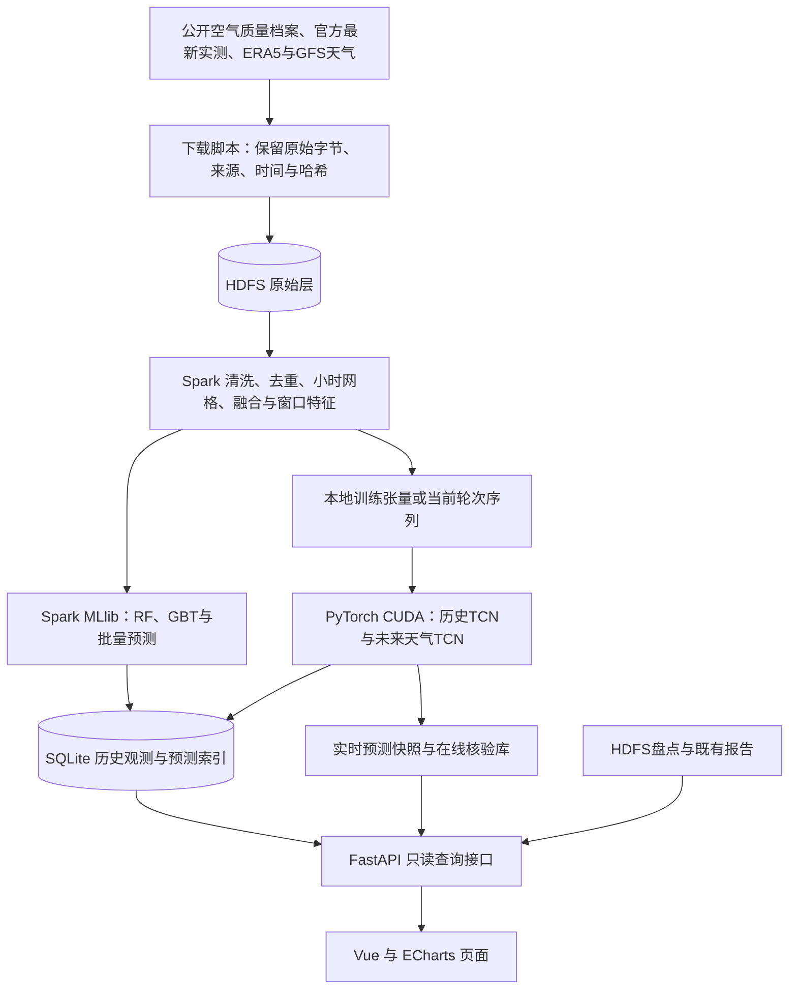

# 北京市 PM₂.₅ 时空分析与短时预测系统

## 项目简介与功能

融合北京、天津、廊坊、保定、唐山、张家口的空气质量和气象资料，分析污染的时间变化与区域差异，并预测当前北京未来六个整点的 PM₂.₅。系统保留城市历史分析、站点实验和当前在线预测三条完整链路。

| 系统代次 | 数据与用途 | 主要模型 | 页面入口 |
| --- | --- | --- | --- |
| 城市版 | 2015-01-01 至 2025-12-31，城市小时均值 | 持续性、Spark RF / GBT | 区域概览、时空分析、预测回放、模型评估、数据质量 |
| 站点版 | 2022-01-01 至 2025-12-31，保留站点差异及过去天气 | Spark RF、CUDA TCN | 站点与 GPU |
| 未来天气与实时版 | 已归档预报用于离线实验，当前实测用于线上发布 | 未来天气分位数 TCN、独立区间校准 | 实时预测、在线核验 |

功能包括地图和时间曲线、气象关联、历史预测回放、模型与基线比较、当前单站及覆盖站点均值预测、预测区间、实测到达后的在线核验和 CSV 导出。网页的“大数据平台”页展示 HDFS 盘点、组件版本和各阶段产物，数据来自 [`/api/system`](http://localhost:8000/api/system)。

历史测试成绩用于比较方法，**不能当作当前实时精度承诺**。三个代次的目标、时间段和样本队列不同，跨代分数不直接排名。

## 系统架构与教材对照



Spark 实际版本为 **3.5.8**，以 **local[4]** 运行；这是单机实验环境。HDFS 保存可追溯原始层、Parquet 特征和 Spark 模型，SQLite 承担网页查询。TCN 的训练和推理由 PyTorch 执行，Spark 负责其上游数据处理。组件版本只引用报告，尚未记录的版本在接口中为空。

| 教材案例 | 本项目 | 替换理由 |
| --- | --- | --- |
| Scrapy | requests 下载脚本 | 数据源提供 CSV/JSON 和固定接口；直接请求、重试、缓存和哈希清单已能完成采集 |
| Kettle | Spark 清洗 | 在同一处理引擎内完成类型校验、网格、连接和窗口计算，清洗规则可用测试检查 |
| MySQL | SQLite | 本地演示以查询已发布结果为主，文件数据库便于交付，减少数据库服务维护 |
| Scala | PySpark | 保留 Spark SQL、DataFrame 和 MLlib 能力，并直接衔接 Python 数据工具与 PyTorch |
| Node.js | FastAPI + Vue | Python 后端便于读取模型报告和查询库，Vue 负责交互与图表 |
| HDFS | HDFS | 保留原始层、处理层和模型的实际文件存储与分层验证 |
| Spark MLlib | Spark MLlib | 真实拟合并保存树模型管线，独立重载后可与网页预测核对 |

本项目借鉴教材的数据流水线思路，具体工具依据现有数据格式、本地运行方式和模型需求选择。

## 数据来源与实际规模

空气质量历史城市数据来自 [quotsoft 公开档案](https://quotsoft.net/air/)，并使用公开镜像加速获取；站点档案来自 [CNEMC 公开归档](https://github.com/HeQinWill/CNEMC)，固定提交见 `reports/station_summary.json.archive_commit`。当前空气质量读取中国环境监测总站公开逐站接口，近期历史使用 quotsoft 原始 CSV。

历史天气使用 [Open-Meteo 历史天气接口](https://open-meteo.com/en/docs/historical-weather-api)的 ERA5 再分析。当前主模型训练与推理都采用 [Previous Runs API](https://open-meteo.com/en/docs/previous-runs-api) 的 GFS 固定提前 **24 小时**预报。同城空气站共享城市代表坐标的天气格点资料，气象值属于模型资料。

| 规模指标 | 实际值 | 报告来源 |
| --- | ---: | --- |
| 城市空气质量原始日文件 | 4,011 | `data_summary.json.download_summary.air.ok` |
| 城市气象文件 | 66 | `data_summary.json.download_summary.weather.ok` |
| 城市版原始数据字节数 | 1,699,384,831，约 1.70 GB | `data_summary.json.raw_bytes` |
| 城市×小时完整网格 | 578,592 行 | `data_summary.json.panel_rows` |
| 城市有效 PM₂.₅ 小时 | 564,028 | `data_summary.json.pm25_valid_hours_all_cities` |
| 全国站点原始小时文件 | 34,580 | `station_summary.json.source_file_count` |
| 全国站点原始档案字节数 | 11,205,092,271，约 11.21 GB | `station_summary.json.raw_archive_bytes` |
| 六城历史站点 | 81 个 | `station_summary.json.stations` |
| 站点×小时完整网格 | 2,840,184 行 | `station_summary.json.grid_hours` |
| 站点有效 PM₂.₅ 小时 | 2,503,919 | `station_summary.json.valid_pm25` |
| 站点原始日期覆盖 | 1,456 / 1,461 天 | `station_summary.json.source_days / expected_days` |
| 站点 Spark 特征 | 150 列；天气历史窗口 72 小时 | `station_summary.json` |
| 站点查询库 | 1,514,590,208 字节 | `station_summary.json.web_database_bytes` |
| 未来天气有效城市小时 | 102,552 | `forecast_training_data.json.weather_valid_hours` |

GB 按十进制换算。全国原始档案包括六城之外的站点，不能把全部原始字节都说成有效建模数据。完整网格行数包含缺失观测；查询库和压缩包也不是原始数据体积。

城市原档缺少的日期为 `20150101, 20181222, 20181223, 20181224, 20181225, 20181226, 20190824`；这些日期来自报告，保留为空。原始数据、请求参数、来源提交和哈希分别保存在 `data/manifests/` 和轮次清单中。

HDFS 实际盘点快照：`2026-10-23T00:04:56.062858+08:00`。下表字节数为内容逻辑大小，不乘副本数；实时目录随轮次增加。

| HDFS 子目录 | 目录数 | 文件数 | 逻辑字节数 |
| --- | ---: | ---: | ---: |
| `raw` | 25 | 4,077 | 1,699,384,831 |
| `processed` | 25 | 24 | 21,242,635 |
| `models` | 224 | 252 | 8,659,031 |
| `stations_v2` | 269 | 3,086 | 7,370,635,975 |
| `live_v1` | 86 | 380 | 171,077,081 |
| `forecast_v3` | 5 | 66 | 54,182,170 |

来源：`reports/hdfs_inventory.json.entries`。站点原始小文件按月无损封装后入 HDFS，以减少小文件开销；传输清单保留每份原始记录的路径、偏移及校验信息。

## Spark 数据处理流程

1. **读取原始层。** `spark_prepare.py` 处理城市 CSV/天气 JSON，`spark_station_prepare.py` 处理站点档案，`prepare_live_data.py` 处理当前轮次。输入实际来自 HDFS。
2. **清洗与去重。** 解析观测时间和数值；非法值、负值及冲突值置空并计数。实时官方数据具有更高优先级，同小时官方缺失不使用低优先级归档替换。
3. **先补网格再算窗口。** 以城市或站点和连续小时建立完整网格，避免缺测导致“上一行”被误认为“上一小时”。
4. **融合天气和周边城市。** 按城市/站点及实际小时连接。站点输入包括污染物、过去天气、时间周期、位置与区域污染。
5. **建立因果特征和标签。** 滞后、滚动窗口只访问起点及过去；未来 PM₂.₅ 只作为训练/评估标签。各标签时刻也必须留在所属时间划分内。
6. **输出与建模。** 写出 Parquet、质量和规模报告。Spark MLlib 训练树模型；序列另转为张量供 CUDA TCN 使用。历史预测写入 SQLite，实时推理写入带版本的快照。

HDFS 负责存储，Spark 负责计算，PyTorch 负责 TCN。当前单机也可以用其他分块工具处理这些数据；这里使用 Spark 展示可重复的并行清洗、连接、窗口计算和模型管线，不声称已经完成多机性能实验。

## 模型与评估

浓度误差单位均为 μg/m³。MAE 是平均绝对误差，RMSE 对大误差更敏感；越低越好。持续性基线直接沿用起点浓度。预处理统计只在训练期拟合，缺失目标不填补，模型和基线使用相同有效样本。推荐模型只依据验证或选择期结果确定。

### 城市版：长期城市均值回放

训练为 **2015-2023**，验证 **2024**，测试 **2025**。划分证据见 `reports/documentation_verification.json.city_split_evidence`，由既有模型登记表提取，未改变模型。输入为北京污染历史、天气及周边城市信息，RF 与 GBT 分提前时长拟合。

| 模型（区域特征） | +1h RMSE | +6h RMSE | +6h MAE | +6h 测试样本 |
| --- | ---: | ---: | ---: | ---: |
| 持续性基线 | 3.5784 | 14.6395 | 9.0336 | 8,239 |
| Spark 随机森林 | 3.0519 | 11.8791 | 7.7986 | 8,239 |
| Spark 梯度提升树 | 2.9921 | 11.7817 | 7.9264 | 8,239 |

固定 RF 的特征对照：

| 特征组 | +6h RMSE | 测试样本 |
| --- | ---: | ---: |
| 北京污染历史 | 13.7219 | 8,239 |
| 加北京当前天气 | 12.4857 | 8,239 |
| 加周边城市污染与天气 | 11.8791 | 8,239 |

来源：`reports/model_metrics.csv`，筛选 `split=test`。表中测试成绩不能参与重新选择推荐模型，天气为事后再分析资料，也不构成在线精度证明。

### 站点版：历史天气与 GPU 模型比较

按 2022—2023 训练、2024 验证、2025 测试。TCN 读取过去 72 小时序列，树模型读取 150 列特征；在北京站点的相同有效目标上比较。

| 模型 | +1h RMSE | +6h RMSE | +6h MAE | +6h 测试样本 |
| --- | ---: | ---: | ---: | ---: |
| 持续性基线 | 6.1288 | 18.5246 | 11.2992 | 188,952 |
| Spark RF，历史天气窗口 | 5.8219 | 16.4850 | 10.4390 | 188,952 |
| CUDA TCN，历史序列 | 5.5621 | 14.2854 | 9.1361 | 188,952 |

来源：`reports/station_model_metrics.csv`，`split=test, scope=beijing`。RF 仅当前天气的 +6h RMSE 为 **16.4269**，加历史天气后为 **16.4850**，本次没有提升；不能笼统声称增加天气历史一定更准。TCN 与 RF 的表示和容量不同，效果差异也不能单独归因于显卡。

GPU 证据来自 `reports/station_cuda_results.json.gpu`：实际设备 **NVIDIA GeForce RTX 4080 Laptop GPU**，PyTorch **2.14.1+cu126**；训练有效起点 **1,252,207**，采用第 **6** 轮检查点，训练及最终推理耗时 **268.06 秒**。浏览历史结果只查数据库，显卡通常空闲。

### 未来天气版：独立校准与当前推理

训练、选模、校准和测试严格分开（`reports/forecast_training_data.json.splits`）：

| 用途 | 时间段 | 有效起点样本 |
| --- | --- | ---: |
| 训练 | 2024-01-01..2024-08-31 | 382,388 |
| 模型选择 | 2024-09-01..2024-10-31 | 34,041 |
| 独立区间校准 | 2024-11-01..2024-12-31 | 34,656 |
| 最终测试 | 2025-01-01..2025-12-31 | 193,411 |

相同数据和划分下比较关闭/打开未来天气输入。历史天气也统一为固定提前量 GFS；天气归档缺口不插补，只有完整历史和未来天气的样本才参与。模型输出低分位、中位和高分位，再用独立时段扩大区间。内部直接输出的时长覆盖发布延迟，页面选取当前未来六个整点。

北京站点 +6h 测试，同一队列：

| 方法 | RMSE | MAE | 样本数 | 区间实际覆盖率 | 平均区间宽度 |
| --- | ---: | ---: | ---: | ---: | ---: |
| 持续性基线 | 18.4721 | — | 187,991 | — | — |
| 历史序列对照 | 16.1949 | 10.2356 | 187,991 | 80.98% | 30.1725 |
| 加未来天气 | 14.7300 | 9.5638 | 187,991 | 81.46% | 29.0906 |

完整共同站点组合的北京均值另行校准。+6h 共 **7,340** 个起点小时，模型 RMSE **11.2451**，基线 **14.4133**，区间覆盖 **83.62%**，平均宽 **24.7474 μg/m³**。这不是站点级队列的同一种统计。

区间名义目标为 **80%**，实际覆盖以测试和后来收到的在线实测为准。+1h 模型 RMSE **6.2913**，基线 **6.1153**，当前模型并非所有时长都优于基线。上述结果全部来自 `reports/forecast_model_results.json.runs`。

当前模型版本：`90a9fbbd5415a6a1a68e357d97c5eb83c8b6e5b74c8db6077b868249d502a81c`。已发布结果保留当时模型与区间；线上记录等真实目标观测到达后才评分，跨版本分开统计。稳定实时表现需要持续积累，历史回放不计作在线运行。

## 运行方法

直接双击项目根目录 **`启动系统.cmd`**，打开 [本地系统](http://localhost:8000/#live)；停止时双击 `停止系统.cmd`。已有原始数据、数据库和模型可以直接复用。

WSL 中启动与停止（运行环境详见 [CLAUDE.md](CLAUDE.md)）：

```bash
cd /mnt/d/Coding/sem5exp/jieduaner/pm25-system
bash scripts/start.sh
bash scripts/stop.sh
```

日常运行只执行需要的启动或停止命令。历史分析和回放查询 SQLite；当前刷新还需 HDFS，流水线会尝试启动已配置的 Hadoop。网络采集在既有 Windows Python 中执行以使用当前网络，Spark 和 PyTorch 在 WSL 项目虚拟环境中执行。

更新实时预测可在网页点击刷新或调用：

```bash
curl -X POST http://127.0.0.1:8000/api/live/refresh
curl http://127.0.0.1:8000/api/live/meta
```

查看组件证据和更新只读 HDFS 盘点：

```bash
/home/hadoop/venvs/pm25/bin/python scripts/hdfs_inventory.py
curl http://127.0.0.1:8000/api/system
```

本轮维护不需要重新下载、重跑清洗或训练；完整历史重建命令及覆盖条件见 `CLAUDE.md`，应先确认确有重建需要。接口参数、时效、刷新限频、错误和 CSV 字段见 [docs/api.md](docs/api.md)。

## 测试与交付核验

在 WSL 项目根目录使用既有环境运行全量测试：

```bash
JAVA_HOME=/usr/lib/jvm/java-11-openjdk-amd64 \
SPARK_LOCAL_IP=127.0.0.1 \
PYSPARK_PYTHON=/home/hadoop/venvs/pm25/bin/python \
/home/hadoop/venvs/pm25/bin/python -m unittest discover -s tests -v
```

覆盖原始字段和单位、冲突/缺失、小时网格、跨年度标签、过去窗口、CUDA 因果性与梯度、真实 SQLite 接口、模型版本、在线等待实测、区间、参数及 Bash LF 换行。组件接口测试还验证请求期间不调用外部命令。

本轮完整测试 **40 项通过**；运行日志与耗时汇总在 `reports/documentation_verification.json.test_runs`。README 的数字抽查也保存在该报告中。

答辩讲述、真实数据走读、页面说明及教师问答见 [docs/答辩讲解.md](docs/答辩讲解.md)。

服务运行时执行城市缓存核验；站点核验会只读加载既有 HDFS / CUDA 模型：

```bash
/home/hadoop/venvs/pm25/bin/python scripts/verify_delivery.py
bash scripts/run_spark.sh station-verify
/home/hadoop/venvs/pm25/bin/python scripts/predict_forecast_live.py --cycle 已有成功轮次编号 --verify-only
```

`verify_delivery.py` 保留了原城市测试日志核对，完整测试应以 `unittest discover` 和本轮日志为准。重构前后同一轮次的中位预测、上下限、来源哈希和交付核验报告一致，证据见 `logs/baseline/`、`logs/phase1-verification/` 和 [执行记录](docs/codex-log.md)。日志是本地运行证据，按既有规则不纳入 Git。

## 目录与产物

| 路径 | 作用 |
| --- | --- |
| `config.json` | 城市、数据日期、天气字段和 HDFS 根路径 |
| `scripts/` | 采集、Spark 清洗、训练、推理、盘点与核验脚本 |
| `server/`、`frontend/` | 后端接口与网页界面源码（Vue 3 + ECharts） |
| `data/manifests/` | 历史文件来源、提交和逐文件/传输包校验 |
| `data/raw/`、`data/stations/cnemc-public/` | 大体积原始数据，Git 忽略 |
| `data/forecast_weather/` | 训练用固定提前量 GFS 原始响应和清单 |
| `data/app/` | 城市观测、城市预测、站点查询 SQLite，Git 忽略 |
| `models/registry.json`、`models/station_registry.json` | 已训练模型登记、参数与推荐规则 |
| `models/station_tcn72.pt` | 站点 TCN 权重，实时预测回退时使用 |
| `models/forecast_tcn9.pt` | 未来天气 TCN 权重，用于实时预测 |
| `models/forecast_history_control.pt` | 历史天气对照模型权重 |
| `models/versions/` | 在线核验按哈希冻结的权重副本，Git 忽略 |
| `reports/` | 规模、质量、模型指标、GPU 证据和核验输出 |
| `data/live/cycles/` | 每轮原始响应、来源清单、特征摘要与预测 |
| `data/live/latest.json`、`data/live/online.sqlite` | 当前快照与真实在线核验记录 |
| `tests/` | 单元和真实数据接口测试 |
| `docs/api.md`、`docs/codex-log.md` | 接口契约、阶段验收与数字来源 |
| `logs/` | 服务、流水线、测试与基线日志，Git 忽略 |

HDFS 根目录为 `hdfs://localhost:9000/user/hadoop/pm25_beijing/2015_2025`。WSL 的 `/home/hadoop/.cache/pm25/` 还保存训练张量和实时序列，运行环境位于 `/home/hadoop/venvs/pm25`；项目文件夹包含源码与主要本地产物，完整运行还依赖这些 WSL/HDFS 文件。

## 已知局限

- 历史 ERA5 为再分析资料；新模型虽统一了训练和线上预报口径，离线成绩仍不等于未来在线精度。
- 高浓度目标分组 +6h：样本 **12,126**，模型 RMSE **35.56**，基线 **33.19**，区间覆盖 **55.39%**。当前模型在这一组劣于基线。
- 突变分组 +6h：样本 **31,963**，区间覆盖 **44.60%**。整体覆盖达标不能保证污染突变时区间可靠。分组定义见报告 `regimes` 及接口文档。
- 区间覆盖率受站点/时间依赖、年际变化和实时输入分布影响；当前浓度参考线仅用于项目观察，不能作为官方预警。
- 同城站点共享天气格点，站点搬迁没有同质化处理；北京覆盖站点均值也不等同于官方城市评价浓度。
- 数据源可能缺测、限流或暂时不可用。服务保留明确状态，旧快照过期后拒绝作为当前预测提供；历史数据库仍可用于回放演示。
- 电脑休眠、服务停止或断网会留下在线覆盖缺口。在线核验需持续运行后再判断成熟程度，本次不宣称已完成长期在线验证。
- 当前 HDFS/Spark 为单机实验，尚无多节点扩容和分布式性能对比。接口证据展示实际运行结果，不代表已经完成集群压测。
